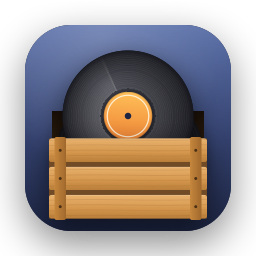

# Crate



A music player for the Mac that opens and plays. Point it at a folder, it
reads the tags, and you listen. No account, no cloud, no store, no settings
screen.

Written in Swift, GPLv3, fully offline, no proprietary services. macOS
only, by decision: the audio stack, the media keys and the Now Playing
integration all come straight from the system.

## Status

This repository holds **CrateCore**, the UI-free Swift package, and the
**Crate** app on top of it. The app works end to end against a real
collection: pick a folder, browse the album grid with covers, search,
play with gapless transitions, and control it from the media keys and
Control Center. Version 0.1.0 is the first release; see `CHANGELOG.md`
for what is in it.

## Download

Each release on the Releases page ships one universal DMG (Apple silicon
and Intel) for macOS 12 Monterey or later. Open it, drag Crate to
Applications, and start it once via right-click > Open: the app is
ad-hoc signed, there is no Developer ID behind it, and Gatekeeper asks
only that first time. Then pick a folder, or choose Crate > Use Crate for
Audio Files so that double-clicking a music file in Finder opens Crate.

What the package does:

- **Scan** a folder recursively for audio files (`LibraryScanner`)
- **Read tags** and duration with AVFoundation (`AVFoundationMetadataReader`)
- **Keep an index** of folders and tracks, persisted as one JSON file in
  Application Support, with incremental rescans: unchanged files are not
  re-read, removed files are dropped (`Library`, `JSONLibraryStore`)
- **Group albums** by folder and loosely compared tags (`Album`): a
  compilation without album artist, a title spelled two ways or a stray
  ";" in one artist tag does not split a folder into several albums, and
  untagged tracks are named after their folder
- **Queue** tracks with repeat, shuffle, play-next and removal (`PlayQueue`)
- **Play** through `AVAudioEngine`, with the next track scheduled behind
  the current one for gapless albums (`AudioPlayer`,
  `AVAudioEngineBackend`; `AVAudioPlayerBackend` is the simpler fallback)
- **Find covers** embedded in the files or lying next to them and cache
  them as thumbnails (`ArtworkReader`, `ArtworkCache`)
- **Search** titles, artists and albums (`SearchQuery`)

Formats are whatever AVFoundation decodes: MP3, AAC/M4A, FLAC, ALAC, WAV,
AIFF, CAF. Ogg Vorbis and Opus are not supported, because the system
cannot play them.

The tag reader goes through AVFoundation's common keys, then ID3 and
iTunes identifiers (including iTunes' binary genre index and the "(17)"
style ID3v1 references). FLAC is parsed by Crate itself
(`FLACMetadata`: STREAMINFO, Vorbis comments and embedded pictures),
because AVFoundation does not expose Vorbis comments on every macOS
version. Checked against real MP3, M4A and FLAC files; reports with a
sample file for anything that reads wrong are welcome.

## Build and test

```sh
swift build
swift test
```

Building needs Swift 6 and Xcode (the Command Line Tools alone lack the
SwiftUI and Swift Testing macro plugins). The app runs on macOS 12
Monterey and later, on Apple silicon and Intel.

To build the app itself:

```sh
scripts/bundle.sh      # -> build/Crate.app, ad-hoc signed
open build/Crate.app
scripts/dmg.sh --universal   # -> build/Crate-<version>.dmg, what a release ships
scripts/install.sh           # -> /Applications/Crate.app, registered with Launch Services
```

Crate > Use Crate for Audio Files binds every audio type (MP3, M4A, FLAC,
WAV, AIFF, ...) to the running copy, which should be the one in
/Applications. A file opened from Finder then plays its album from that
track if the file is in the library, or just the opened files if not; a
folder dropped on the app is added to the library.

Releases are cut by pushing a `v*` tag that matches the version in
`Packaging/Info.plist`; the workflow builds the DMG and takes the release
notes from `CHANGELOG.md`.

To see what the tag reader makes of a real folder:

```sh
swift run crate-scan ~/Music/Music/Media.localized        # summary + tracks with gaps
swift run crate-scan <folder> --all                       # every track
```

## Layout

```
Sources/CrateCore/    the package
Sources/Crate/        the SwiftUI app
Sources/crate-scan/   developer tool, not part of the app
Tests/CrateCoreTests/
Packaging/            Info.plist (the one place the version lives) and AppIcon.icns
scripts/              bundle.sh (build Crate.app), dmg.sh (release DMG), install.sh
                      (copy to /Applications and register), icon.sh/icon.swift
                      (regenerate the icon), screenshot.sh (dev aid)
```

Design rules the code follows:

- The package has no UI and no global state. `Library` is an actor,
  `PlayQueue` is a value type, everything else is a plain struct or a
  protocol.
- Everything with I/O sits behind a protocol (`MetadataReader`,
  `ArtworkReader`, `LibraryStore`, `AudioPlayer`), so tests run with fakes
  and the app with the AVFoundation implementations.
- Defaults over options. If something can be decided for the user, it is.

## License

GPL-3.0-or-later, see `LICENSE`.

See `AI_POLICY.md` for how AI tooling is used in this project,
`PRIVACY.md` for what the app does with your data (nothing leaves your
Mac) and `THIRD-PARTY-NOTICES.md` for dependencies (there are none beyond
the system frameworks).
